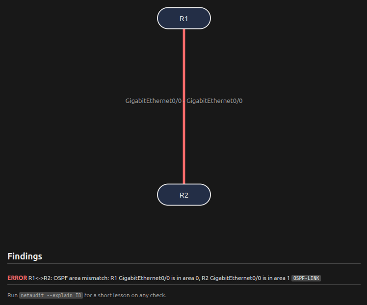
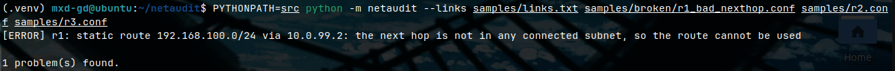
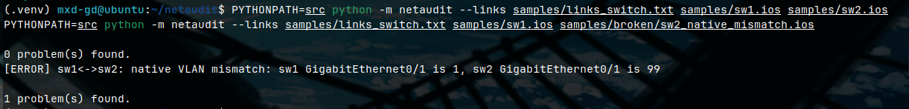

# netaudit

A read-only config auditor for small network labs (Packet Tracer, GNS3 or real
gear). It reads device configs, catches classic CCNA-level mistakes, explains
each one in plain words, and documents the lab as a Markdown or HTML report.

It is for people studying for the CCNA, people building labs who want a second
pair of eyes, and anyone who wants a quick sanity check before touching a device.
It never connects to a device and never changes anything: it only reads files.

The checks are plain deterministic Python. The same input always gives the same
findings, and every check has tests. There is no AI in the checks.

## What it catches

An IOS router config with four planted mistakes:

    $ netaudit samples/broken/acl_mistakes.ios
    [ERROR] edge1: GigabitEthernet0/0 applies ACL GHOST (out), but no ACL with that name or number is defined; on Cisco IOS an undefined ACL lets all traffic through  (ACL-UNDEFINED)
    [WARNING] edge1: ACL UNUSED is defined but not applied to any interface (it may be used by NAT, a VTY line or a route map, which are not checked yet)  (ACL-UNUSED)
    [WARNING] edge1: ACL BLOCK_WEB: 'permit ip any any' matches all traffic, so the 1 rule(s) after it never run  (ACL-SHADOWED)
    [ERROR] edge1: ACL BLOCK_WEB: 'deny tcp 192.168.1.0 255.255.255.0 any eq 80' uses 255.255.255.0 where a wildcard mask belongs; did you mean 0.0.0.255?  (ACL-MASK)

    4 problem(s) found.

Every finding ends with a check ID. `netaudit --explain ACL-MASK` prints a short
lesson on that mistake: what it is, why it breaks, how to fix it. No internet
and no AI needed.

The same findings as a self-contained HTML report (`--html`), with the broken
link drawn in red:

More examples from the routing and switching checks:

A static route whose next hop is not reachable:

Two switches that disagree about the native VLAN on their trunk:

## Quick start

Needs Python 3.10 or newer and nothing else.

    git clone https://github.com/MxdGd/netaudit.git
    cd netaudit
    python3 -m venv .venv
    source .venv/bin/activate
    pip install .

Audit the sample routers (FRR syntax) and write a report:

    netaudit --links samples/links.txt --doc report.md --html report.html samples/r1.conf samples/r2.conf samples/r3.conf

Open `report.html` in a browser: it is one self-contained file with the topology
diagram (broken links in red), the findings and the tables. It needs no internet.

Files ending in `.ios` use the IOS parser (routers and switches); everything else
is read as FRR. The links file lists one cable per line, like `r1:eth1 r2:eth1`.
The tool exits with status 1 when it finds problems. `samples/broken/` holds
deliberate mistakes you can run it against.

To run the tests: `pip install pytest && pytest`.

## What it checks

| ID | What it catches | Severity |
|---|---|---|
| `SHUTDOWN-IP` | interface with an IP address that is shut down | error |
| `LINK-SUBNET` | two ends of a cable in different subnets, duplicate IP, link end missing | error (warning if an end has no IP) |
| `OSPF-COVERAGE` | interface not covered by an OSPF `network` statement | error |
| `OSPF-LINK` | OSPF area or network type differs across a link | error |
| `OSPF-DUP-RID` | two routers with the same OSPF router ID | error |
| `STATIC-NEXTHOP` | next hop unreachable, own address, or behind a shut interface | error (warning if no device in the lab owns it) |
| `STATIC-RETURN` | static route toward a router that has no route back | warning |
| `DEFAULT-LOOP` | two routers whose default routes point at each other | error |
| `VLAN-UNDEFINED` | access port or trunk using a VLAN that is not defined | error (warning for trunks) |
| `TRUNK-MISMATCH` | mode, access VLAN, native VLAN or allowed VLANs differ across a switch link | error (warning for allowed VLANs) |
| `ACL-UNDEFINED` | ACL applied to an interface but not defined | error |
| `ACL-UNUSED` | ACL defined but never applied | warning |
| `ACL-SHADOWED` | rules after a match-everything rule never run | warning |
| `ACL-MASK` | subnet mask written where a wildcard mask belongs | error |

How each check is tested and everything the tool does not do:
[VALIDATION.md](VALIDATION.md)

## What it does not do

- It reads configs; it does not simulate packets or OSPF. Where that matters, the
  finding is a warning, not an error.
- A config line the parser does not understand is never ignored silently: it is
  listed as `[NOT CHECKED]`, so you know what was not looked at.
- ACL checks work on IOS syntax only; the FRR parser does not read ACLs.
- Not supported yet: `interface range`, `switchport trunk allowed vlan remove/except`,
  ACL rules with extra options such as `dscp`, NAT and DHCP.
- It has been tested against small hand-written labs, not large production networks.

## FRR to Cisco IOS commands

The routing samples use FRRouting syntax, which is close to IOS. These are the
commands the tool reads, side by side.

| What | FRR | Cisco IOS |
|---|---|---|
| Enter configuration | `configure terminal` (in `vtysh`) | `configure terminal` |
| Interface name | `eth1` | `GigabitEthernet0/1` |
| IP address | `ip address 10.0.12.1/30` | `ip address 10.0.12.1 255.255.255.252` |
| Shut / enable an interface | `shutdown` / `no shutdown` | `shutdown` / `no shutdown` |
| Start OSPF | `router ospf` | `router ospf 1` |
| OSPF router ID | `ospf router-id 1.1.1.1` | `router-id 1.1.1.1` |
| OSPF network statement | `network 10.0.12.0/30 area 0` | `network 10.0.12.0 0.0.0.3 area 0` |
| OSPF network type | `ip ospf network point-to-point` | `ip ospf network point-to-point` |
| Static route | `ip route 192.168.100.0/24 10.0.12.2` | `ip route 192.168.100.0 255.255.255.0 10.0.12.2` |
| Show the config | `show running-config` | `show running-config` |
| Show OSPF neighbors | `show ip ospf neighbor` | `show ip ospf neighbor` |
| Show routes | `show ip route` | `show ip route` |
| Show interfaces briefly | `show interface brief` | `show ip interface brief` |

FRR has no switching features, so VLANs and trunks are read from IOS-style
configs (`vlan 10`, `switchport mode access`, `switchport trunk allowed vlan`).

## Status

Version 1.0: a read-only study and sanity-check tool for small labs. It has only
been tested against small hand-written labs, not production networks. Read
[VALIDATION.md](VALIDATION.md) before relying on it.

## Labs

Write-ups with the configs, the planted mistake and what the tool found:

- [Lab 01: OSPF area mismatch](labs/01-ospf-area-mismatch/README.md)

## Roadmap

Planned, roughly in this order. Several are good first contributions.

- Basics: plain-text passwords, SSH prerequisites, speed/duplex mismatch
- NAT and DHCP checks
- Layer 2 extras: EtherChannel mode mismatch, portfast on a trunk, port security
- A local read-only window (`netaudit serve`) with a paste box for Packet Tracer configs
- Reading a GNS3 lab directly
- An intent file: state what the lab should achieve and grade against it

What is covered and how it grows: [COVERAGE.md](COVERAGE.md)

## Contributing

Adding a check is a small job: one function, one ID, one lesson, one test. See
[CONTRIBUTING.md](CONTRIBUTING.md).

## License

MIT, see [LICENSE](LICENSE).
