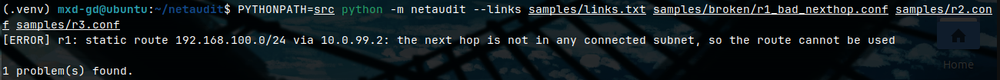
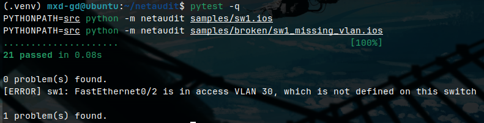
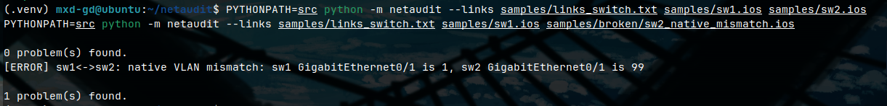

# netaudit

A config auditor and auto-documenter for small networks. It reads device
configs, reports what is wrong or missing, and writes a Markdown document
describing the lab.

I built it to study for the CCNA: each concept I learn becomes a check, so the
tool tells me what I got wrong without re-reading every config by hand.

The checks are plain deterministic Python. The same input always gives the same
findings, and every check has tests. There is no AI in the checks.

## What it does

- Parses FRRouting configs and IOS-style switch configs into one
  vendor-neutral model. Checks only read the model, so a new parser makes
  every existing check work on a new syntax.
- Compares devices across the cables you list in a links file.
- Generates documentation: IP table, links, OSPF, static routes, VLANs,
  switchports and the audit findings.

## Quick start

Needs Python 3.10 or newer.

    git clone https://github.com/MxdGd/netaudit.git
    cd netaudit
    python3 -m venv .venv
    source .venv/bin/activate
    pip install pytest
    pytest

Audit the sample routers (FRR syntax) and write a report:

    PYTHONPATH=src python -m netaudit --links samples/links.txt --doc report.md samples/r1.conf samples/r2.conf samples/r3.conf

Audit a sample switch with a deliberate mistake (files ending in `.ios` use the
IOS parser, everything else is read as FRR):

    PYTHONPATH=src python -m netaudit samples/broken/sw1_missing_vlan.ios

The links file lists one cable per line, like `r1:eth1 r2:eth1`. The tool exits
with status 1 when it finds problems. `samples/broken/` holds one deliberate
mistake per file.

## Example output

A static route whose next hop is not reachable:

An access port in a VLAN that does not exist:

Two switches that disagree about the native VLAN on their trunk:

A full generated report for the sample lab:
[docs/example-report.md](docs/example-report.md)

## What it checks

| Area | Examples |
|---|---|
| Interfaces | administratively shut down |
| Routed links | different subnets on the two ends, duplicate IP |
| OSPF | interface not covered by a `network` statement, area mismatch, network type mismatch |
| Static routes | unreachable next hop, own address as next hop, egress interface shut down |
| VLANs | access port or trunk using an undefined VLAN |
| Trunks | mode, access VLAN, native VLAN and allowed-VLAN mismatch between the two ends |

The full list, how each check is tested, and everything the tool does not do:
[VALIDATION.md](VALIDATION.md)

## FRR to Cisco IOS commands

The routing samples use FRRouting syntax, which is close to IOS. These are the
commands the tool reads, side by side.

| What | FRR | Cisco IOS |
|---|---|---|
| Enter configuration | `configure terminal` (in `vtysh`) | `configure terminal` |
| Interface name | `eth1` | `GigabitEthernet0/1` |
| IP address | `ip address 10.0.12.1/30` | `ip address 10.0.12.1 255.255.255.252` |
| Shut / enable an interface | `shutdown` / `no shutdown` | `shutdown` / `no shutdown` |
| Start OSPF | `router ospf` | `router ospf 1` |
| OSPF router ID | `ospf router-id 1.1.1.1` | `router-id 1.1.1.1` |
| OSPF network statement | `network 10.0.12.0/30 area 0` | `network 10.0.12.0 0.0.0.3 area 0` |
| OSPF network type | `ip ospf network point-to-point` | `ip ospf network point-to-point` |
| Static route | `ip route 192.168.100.0/24 10.0.12.2` | `ip route 192.168.100.0 255.255.255.0 10.0.12.2` |
| Show the config | `show running-config` | `show running-config` |
| Show OSPF neighbors | `show ip ospf neighbor` | `show ip ospf neighbor` |
| Show routes | `show ip route` | `show ip route` |
| Show interfaces briefly | `show interface brief` | `show ip interface brief` |

FRR has no switching features, so VLANs and trunks are read from IOS-style
configs (`vlan 10`, `switchport mode access`, `switchport trunk allowed vlan`).

## Status

Work in progress and a personal study tool. It has only been tested against
small hand-written samples. See [VALIDATION.md](VALIDATION.md) before relying
on it.
