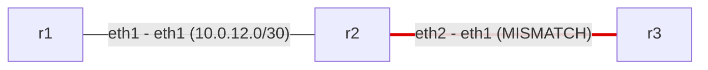

# Network documentation

## Topology

## Devices

| Device | OSPF router-id | Interfaces |
|---|---|---|
| r1 | 1.1.1.1 | 2 |
| r2 | 2.2.2.2 | 3 |
| r3 | 3.3.3.3 | 2 |

## IP addressing

| Device | Interface | IP | Subnet | OSPF area | Config state |
|---|---|---|---|---|---|
| r1 | lo | 1.1.1.1/32 | 1.1.1.1/32 | 0 | up |
| r1 | eth1 | 10.0.12.1/30 | 10.0.12.0/30 | 0 | up |
| r2 | lo | 2.2.2.2/32 | 2.2.2.2/32 | 0 | up |
| r2 | eth1 | 10.0.12.2/30 | 10.0.12.0/30 | 0 | up |
| r2 | eth2 | 10.0.23.1/30 | 10.0.23.0/30 | 0 | up |
| r3 | lo | 3.3.3.3/32 | 3.3.3.3/32 | 0 | up |
| r3 | eth1 | 10.0.24.2/30 | 10.0.24.0/30 | - | up |

## Links

| End A | End B | Subnet |
|---|---|---|
| r1:eth1 | r2:eth1 | 10.0.12.0/30 |
| r2:eth2 | r3:eth1 | MISMATCH |

## OSPF

### r1

- Router ID: 1.1.1.1
- network 1.1.1.1/32 area 0
- network 10.0.12.0/30 area 0

### r2

- Router ID: 2.2.2.2
- network 2.2.2.2/32 area 0
- network 10.0.12.0/30 area 0
- network 10.0.23.0/30 area 0

### r3

- Router ID: 3.3.3.3
- network 3.3.3.3/32 area 0
- network 10.0.23.0/30 area 0

## Static routes

| Device | Prefix | Via |
|---|---|---|
| r1 | 192.168.100.0/24 | 10.0.12.2 |

## VLANs

_No VLANs defined._

## Switchports

_No switchports._

## Not checked

_Every line was understood._

## Audit findings

- **ERROR** r3: eth1 (10.0.24.2/30) is not covered by any OSPF network statement, so OSPF does not run on it
- **ERROR** r2<->r3: subnet mismatch: r2 eth2 10.0.23.1/30 vs r3 eth1 10.0.24.2/30
