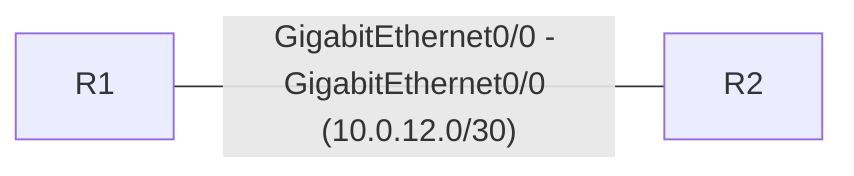

# Network documentation

## Topology

## Devices

| Device | OSPF router-id | Interfaces |
|---|---|---|
| R1 | 1.1.1.1 | 3 |
| R2 | 2.2.2.2 | 3 |

## IP addressing

| Device | Interface | IP | Subnet | OSPF area | Config state |
|---|---|---|---|---|---|
| R1 | Loopback0 | 1.1.1.1/32 | 1.1.1.1/32 | 0 | up |
| R1 | GigabitEthernet0/0 | 10.0.12.1/30 | 10.0.12.0/30 | 0 | up |
| R1 | GigabitEthernet0/1 | - | - | - | shutdown |
| R2 | Loopback0 | 2.2.2.2/32 | 2.2.2.2/32 | 0 | up |
| R2 | GigabitEthernet0/0 | 10.0.12.2/30 | 10.0.12.0/30 | 0 | up |
| R2 | GigabitEthernet0/1 | 192.168.100.1/24 | 192.168.100.0/24 | 0 | up |

## Links

| End A | End B | Subnet |
|---|---|---|
| R1:GigabitEthernet0/0 | R2:GigabitEthernet0/0 | 10.0.12.0/30 |

## OSPF

### R1

- Router ID: 1.1.1.1
- network 1.1.1.1/32 area 0
- network 10.0.12.0/30 area 0

### R2

- Router ID: 2.2.2.2
- network 2.2.2.2/32 area 0
- network 10.0.12.0/30 area 0
- network 192.168.100.0/24 area 0

## Static routes

| Device | Prefix | Via |
|---|---|---|
| R1 | 192.168.100.0/24 | 10.0.12.2 |

## VLANs

_No VLANs defined._

## Switchports

_No switchports._

## Not checked

_Every line was understood._

## Audit findings

No problems found.
